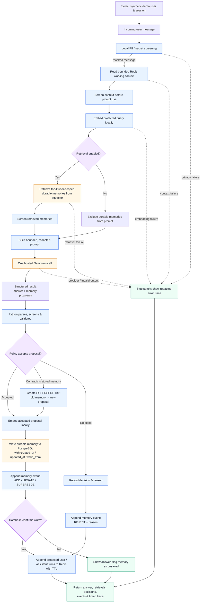

# Memory Layer Pro pipeline

**Legend:** blue = application/local processing, amber = external service,
purple = branch or policy decision, green = learner-visible outcome.

The privacy screen runs before content can reach Redis, pgvector, logs/traces,
event rows, or the hosted model. The model is called exactly once for a successful turn;
Python makes the memory-persistence decisions. Every decision appends one redacted
event row, and contradictions preserve history through SUPERSEDE links instead of
deleting it.
